# Routing Message Flows and Data Flow Diagrams

**Version**: 1.0
**Date**: 2026-02-03

---

## 1. Phase 1: Turn Cost Model Integration

### 1.1 Turn Cost Calculation Flow

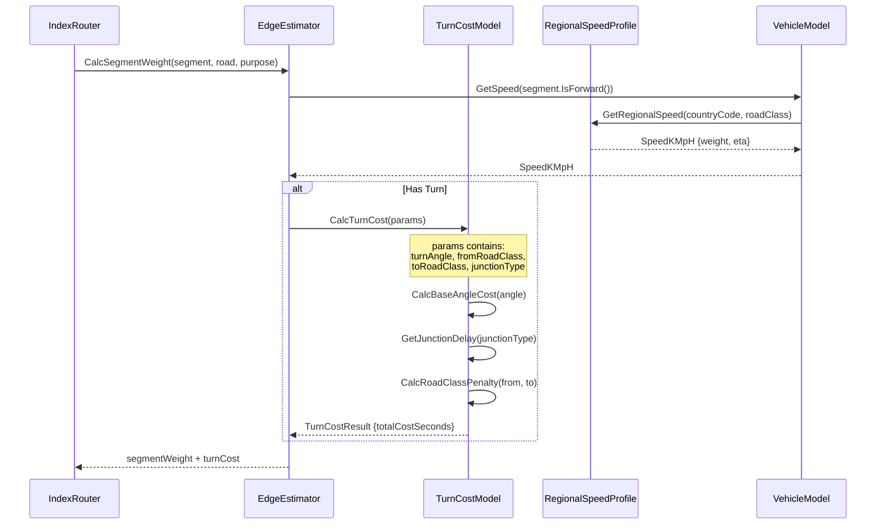

### 1.2 Speed Profile Lookup

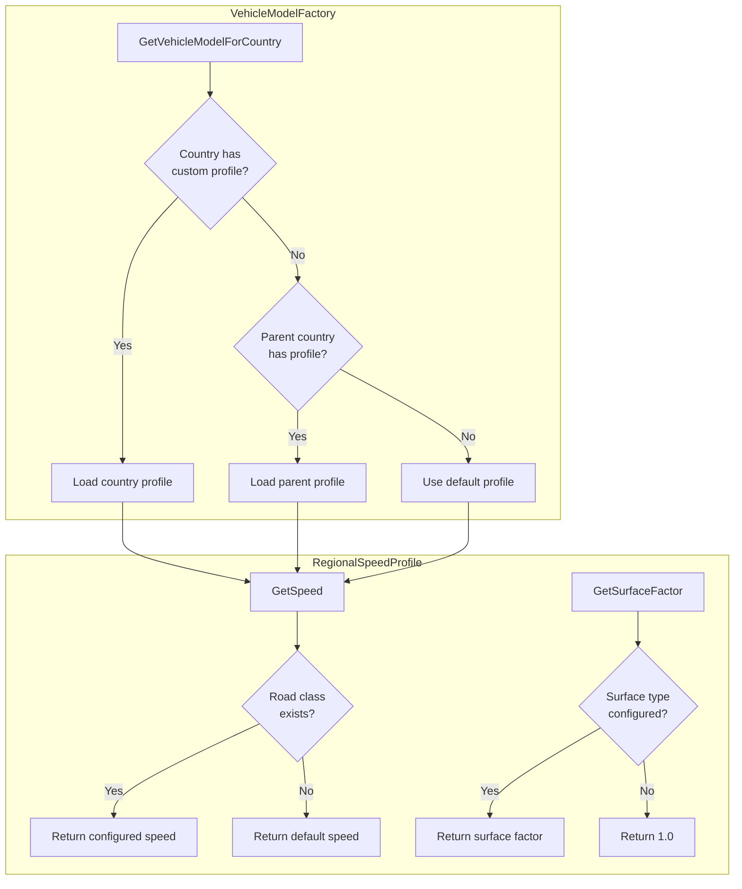

---

## 2. Phase 2: Corridor-Based Route Following

### 2.1 Off-Route Detection State Machine

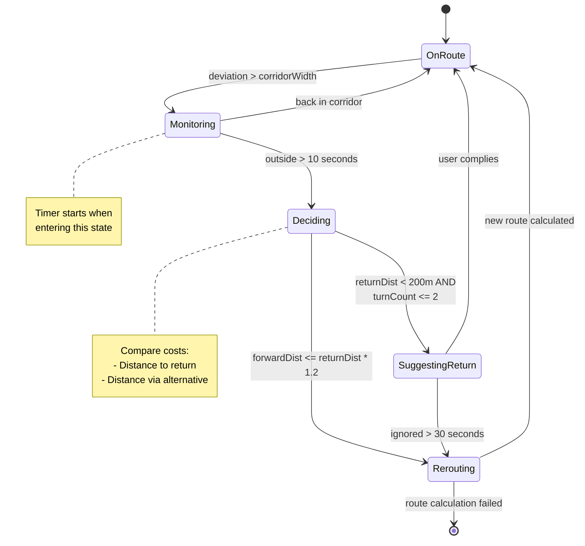

### 2.2 Position Update Processing

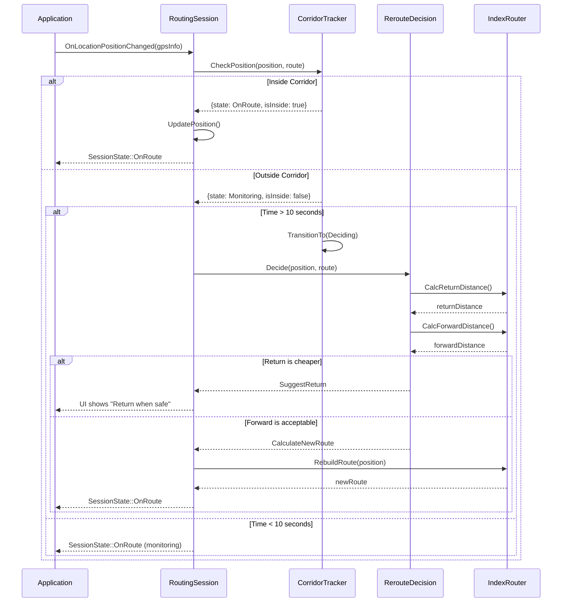

### 2.3 Corridor Width Calculation

```mermaid
flowchart LR
    subgraph Input
        A[Road Class]
        B[GPS Accuracy]
    end

    subgraph "Base Width Table"
        C{Road Class}
        C -->|Motorway| D[50m]
        C -->|Trunk| E[40m]
        C -->|Primary| F[30m]
        C -->|Secondary| G[25m]
        C -->|Tertiary| H[20m]
        C -->|Residential| I[15m]
    end

    subgraph Calculation
        J[baseWidth + max(gpsAccuracy, 10m)]
    end

    A --> C
    D --> J
    E --> J
    F --> J
    G --> J
    H --> J
    I --> J
    B --> J

    J --> K[Corridor Width]
```

---

## 3. Phase 3: CCH Preprocessing

### 3.1 CCH Build Pipeline (Generator)

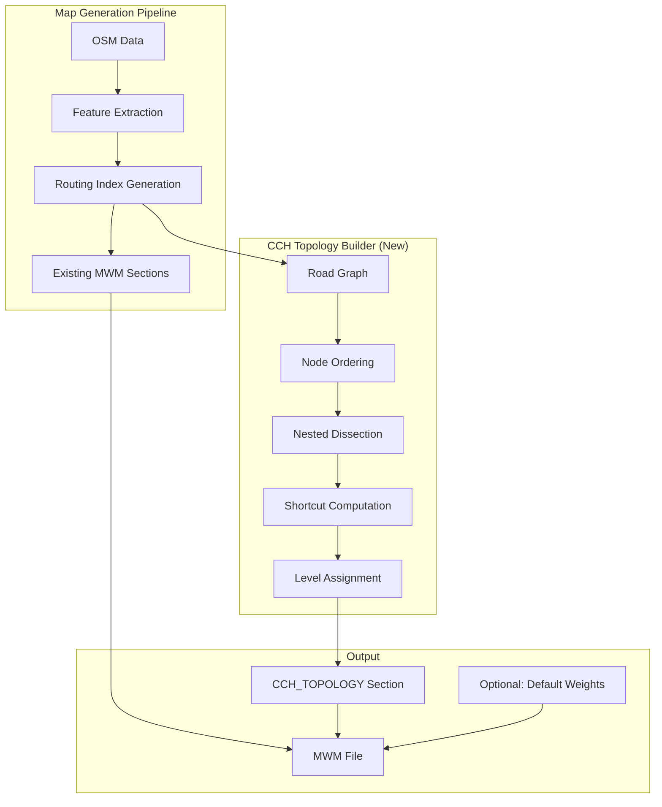

### 3.2 CCH Runtime Flow

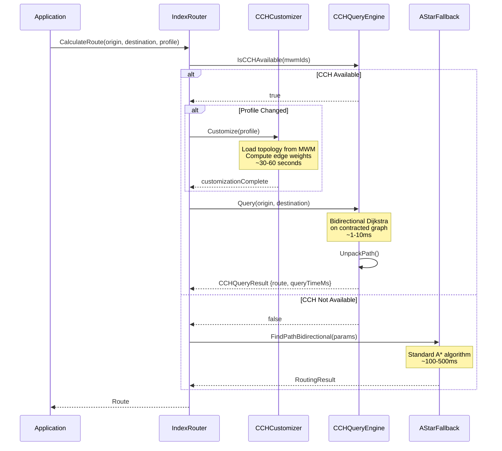

### 3.3 CCH Data Structures

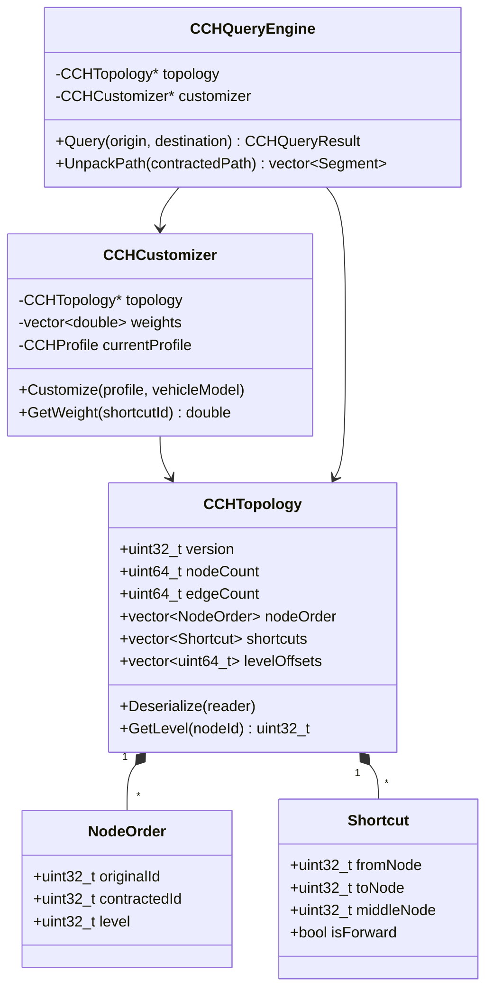

---

## 4. Phase 4: Alternative Routes

### 4.1 k-SPwLO Algorithm Flow

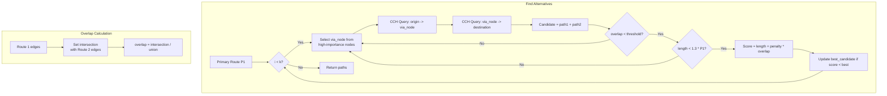

### 4.2 Alternative Route Display Timing

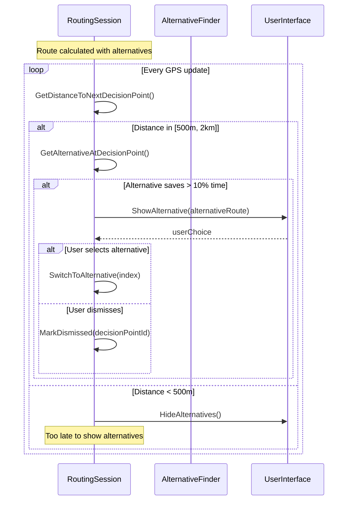

### 4.3 Alternative Routes Storage

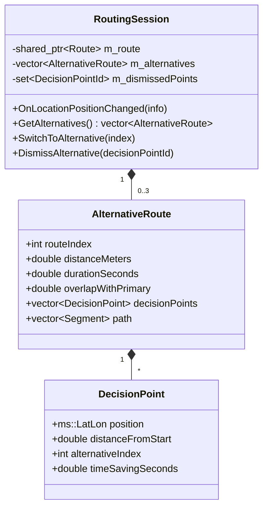

---

## 5. Cross-Phase Integration

### 5.1 Complete Route Calculation Flow

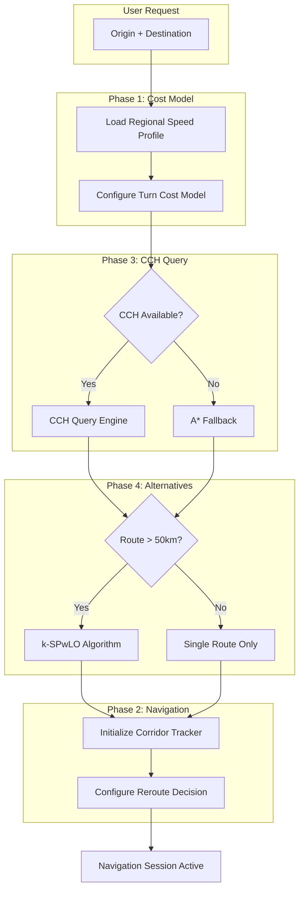

### 5.2 Component Dependencies

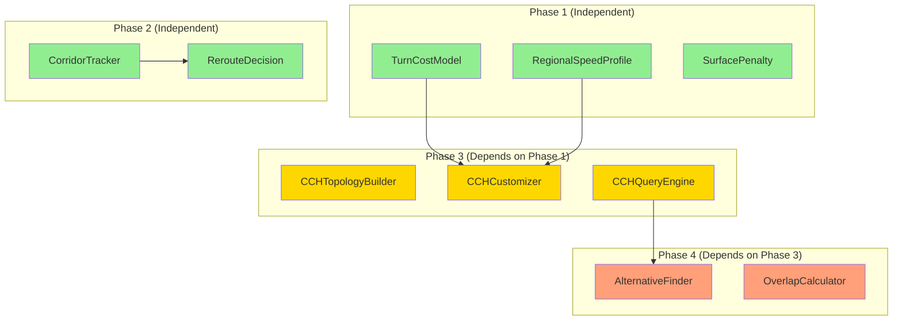

---

## 6. Error Handling and Fallbacks

### 6.1 CCH Fallback Chain

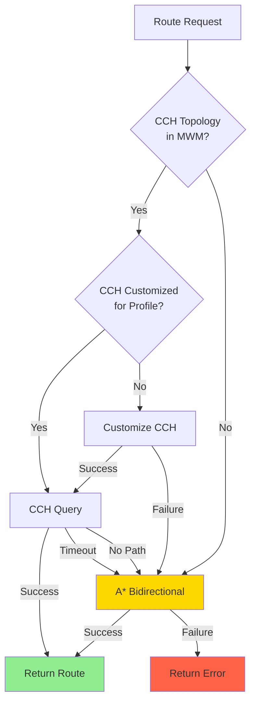

### 6.2 Corridor Recovery

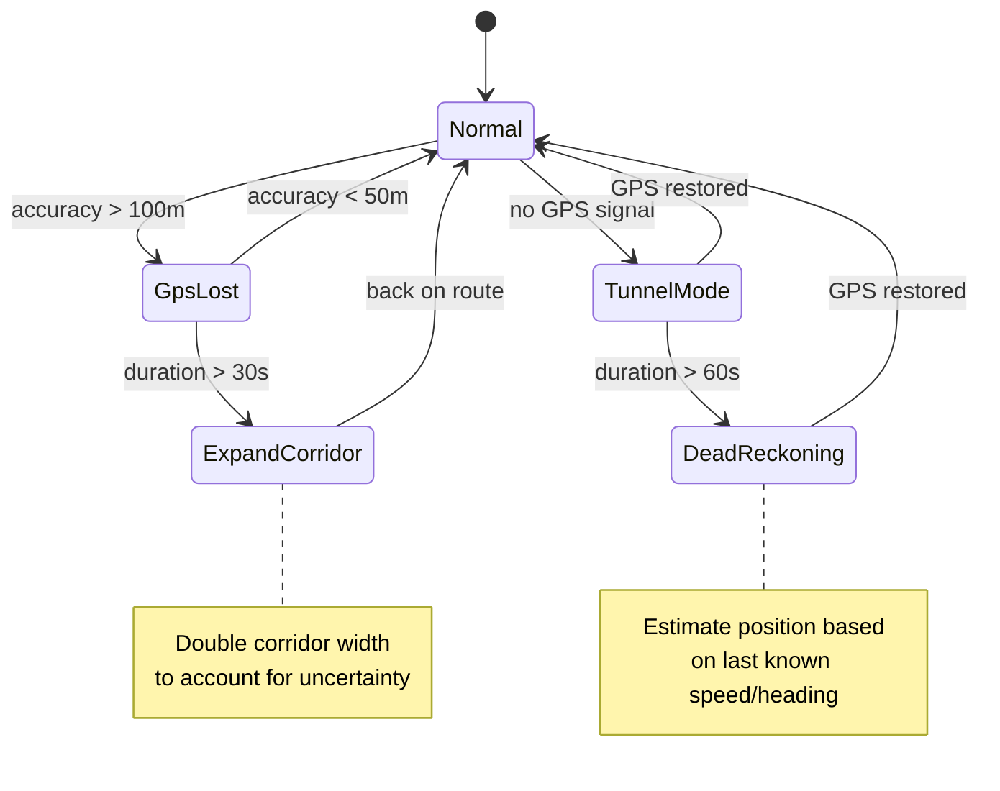
